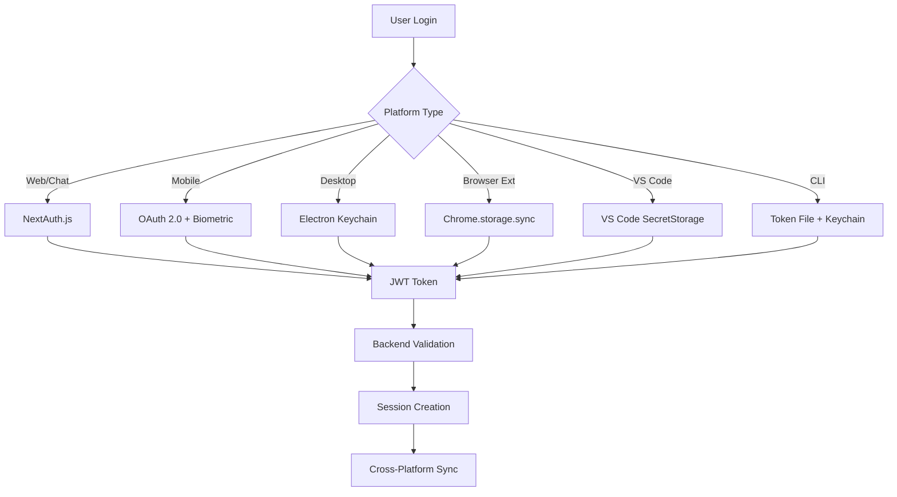
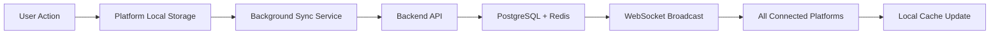
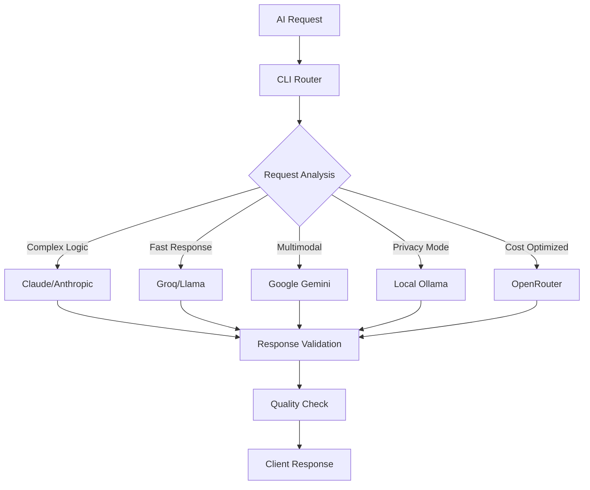

# Cross-Platform Dependency Mapping & Integration Analysis

## 🗺️ System Dependency Overview

This document maps the complex interdependencies across all 12+ Recoder.xyz platforms and services.

---

## 📊 Dependency Matrix

| Platform | Core Dependencies | API Dependencies | Auth Dependencies | Data Dependencies |
|----------|-------------------|------------------|-------------------|-------------------|
| **CLI Core** | CLI Router, Backend | All AI Providers | Unified Auth | Local Config + Cloud Sync |
| **CLI Router** | Backend Services | Load Balancer | Service Auth | Request Routing Cache |
| **Production Engine** | Backend, Validators | AI Hub | Service Auth | Code Validation DB |
| **Backend Services** | Database, Redis | AI Providers | JWT + Session | PostgreSQL + Redis |
| **Chat Platform** | Backend, AI Hub | Anthropic, Groq | NextAuth.js | Session + User Data |
| **Mobile Chat** | Backend, Sync Service | REST + WebSocket | OAuth + Biometric | SQLite + Cloud Sync |
| **Desktop App** | Local AI, Backend | Ollama, LM Studio | Keychain + Token | Local Storage + Sync |
| **Browser Extension** | GitHub API, Backend | Content Scripts | Chrome Storage | Local + GitHub Data |
| **VS Code Extension** | VS Code API, Backend | Language Server | VS Code Auth | Workspace + Settings |
| **Web Platform** | Backend, Monaco | Multiple Providers | Session + OAuth | PostgreSQL + Files |
| **Infrastructure** | K8s, Docker | Monitoring Stack | Service Mesh Auth | Persistent Volumes |
| **Monitoring** | Prometheus, Grafana | All Services | Service Discovery | Time Series Data |

---

## 🔄 Critical Integration Points

### 1. **Authentication Flow Mapping**



### 2. **Data Synchronization Chain**



### 3. **AI Provider Routing Logic**



---

## 📋 Detailed Dependency Analysis

### **Tier 1: Core Infrastructure Dependencies**
**Critical systems that everything depends on**

1. **Backend Services** (`/backend/`)
   - **Dependents**: ALL platforms
   - **Dependencies**: PostgreSQL, Redis, AI Providers
   - **Risk Level**: 🔴 CRITICAL - Single point of failure
   - **Mitigation**: Load balancing, database clustering, multi-region

2. **Authentication System**
   - **Dependents**: All user-facing platforms
   - **Dependencies**: JWT signing, Session storage
   - **Risk Level**: 🔴 CRITICAL - Security cornerstone
   - **Mitigation**: Multi-factor auth, token rotation, secure storage

3. **Database Layer** (PostgreSQL + Redis)
   - **Dependents**: Backend, Chat, Web Platform
   - **Dependencies**: Persistent storage, caching
   - **Risk Level**: 🔴 CRITICAL - Data persistence
   - **Mitigation**: Automated backups, replication, monitoring

### **Tier 2: Platform-Specific Dependencies**

4. **AI Provider Hub**
   - **Dependents**: CLI, Chat, Web, Extensions
   - **Dependencies**: Multiple AI APIs, Router logic
   - **Risk Level**: 🟡 HIGH - Core functionality
   - **Mitigation**: Multi-provider fallback, local AI backup

5. **Production Engine**
   - **Dependents**: Code generation features across platforms
   - **Dependencies**: Validation services, test runners
   - **Risk Level**: 🟡 HIGH - Quality assurance
   - **Mitigation**: Redundant validation, graceful degradation

6. **Cross-Platform Sync Service**
   - **Dependents**: Mobile, Desktop, Extensions
   - **Dependencies**: WebSocket connections, conflict resolution
   - **Risk Level**: 🟡 MEDIUM - User experience
   - **Mitigation**: Offline capabilities, conflict resolution

### **Tier 3: Enhanced Feature Dependencies**

7. **GitHub Integration**
   - **Dependents**: Browser Extension, Web Platform
   - **Dependencies**: GitHub API, OAuth scopes
   - **Risk Level**: 🟢 MEDIUM - Feature enhancement
   - **Mitigation**: Rate limiting, fallback to basic features

8. **Local AI Integration**
   - **Dependents**: Desktop App, Privacy-focused features
   - **Dependencies**: Ollama, LM Studio APIs
   - **Risk Level**: 🟢 LOW - Optional feature
   - **Mitigation**: Cloud AI fallback, clear user messaging

---

## ⚡ Performance-Critical Integrations

### **High-Frequency API Calls**
1. **AI Generation Requests**
   - Volume: 1000-10000+ requests/hour
   - Latency Target: <2 seconds
   - Dependencies: Router → Provider → Validation → Response

2. **Real-time Synchronization**
   - Volume: Continuous WebSocket connections
   - Latency Target: <100ms
   - Dependencies: Platform → Sync Service → Backend → Broadcast

3. **Code Analysis & Validation**
   - Volume: Per-keystroke or on-demand
   - Latency Target: <500ms
   - Dependencies: Editor → Production Engine → Validation → Response

### **Optimization Strategies**
- **Caching Layers**: Redis for frequently accessed data
- **Connection Pooling**: Reuse database and API connections
- **Async Processing**: Background tasks for non-critical operations
- **CDN Distribution**: Static assets and frequently requested responses

---

## 🔐 Security Dependency Chain

### **Trust Boundaries**
1. **Client-Side** (Browser, Desktop, Mobile)
   - Trust Level: ❌ UNTRUSTED
   - Validation: All inputs validated server-side
   - Security: Token-based auth, HTTPS only

2. **API Gateway** (CLI Router, Backend)
   - Trust Level: ⚠️ SEMI-TRUSTED
   - Validation: JWT verification, rate limiting
   - Security: Service-to-service auth, encrypted communication

3. **Core Services** (Database, AI Providers)
   - Trust Level: ✅ TRUSTED
   - Validation: Internal service mesh
   - Security: Network isolation, credential management

### **Data Flow Security**
```
[User Input] → [Client Validation] → [TLS] → [API Gateway] 
    → [JWT Verification] → [Rate Limiting] → [Backend Service]
    → [Input Sanitization] → [Database] → [Encrypted Storage]
```

---

## 🚨 Failure Mode Analysis

### **Critical Failure Scenarios**

1. **Backend API Outage**
   - **Impact**: All platforms affected
   - **Mitigation**: Load balancer failover, graceful degradation
   - **Recovery Time**: 2-5 minutes

2. **AI Provider Outage**
   - **Impact**: Reduced functionality, fallback to available providers
   - **Mitigation**: Multi-provider routing, local AI backup
   - **Recovery Time**: Instant (automatic failover)

3. **Database Failure**
   - **Impact**: Data persistence issues, session loss
   - **Mitigation**: Database clustering, automated failover
   - **Recovery Time**: 1-2 minutes

4. **Authentication System Failure**
   - **Impact**: New logins blocked, existing sessions may continue
   - **Mitigation**: Session caching, emergency bypass
   - **Recovery Time**: 5-10 minutes

### **Graceful Degradation Strategy**
1. **Offline Mode**: Local storage and cached responses
2. **Reduced Functionality**: Core features only during outages
3. **User Communication**: Clear status updates and expectations
4. **Automatic Recovery**: Self-healing where possible

---

## 🎯 Integration Optimization Priorities

### **Phase 1: Reliability (Weeks 1-2)**
- [ ] Implement health checks across all services
- [ ] Add circuit breakers for external dependencies
- [ ] Create comprehensive monitoring dashboards
- [ ] Establish automated failover procedures

### **Phase 2: Performance (Weeks 3-4)**
- [ ] Optimize database queries and indexing
- [ ] Implement intelligent caching strategies
- [ ] Add connection pooling and load balancing
- [ ] Create performance benchmarking suite

### **Phase 3: Security (Weeks 5-6)**
- [ ] Audit all inter-service communication
- [ ] Implement zero-trust security model
- [ ] Add comprehensive audit logging
- [ ] Create security incident response procedures

### **Phase 4: Scalability (Weeks 7-8)**
- [ ] Design horizontal scaling strategies
- [ ] Implement auto-scaling policies
- [ ] Create capacity planning models
- [ ] Establish performance SLAs

---

## 🔧 Development Workflow Dependencies

### **Local Development**
```bash
# Required services for full local development
docker-compose up -d postgres redis
npm run start:backend
npm run start:chat
npm run start:web
npm run start:desktop
```

### **Testing Dependencies**
- **Unit Tests**: Individual service testing
- **Integration Tests**: Cross-service API testing
- **E2E Tests**: Full user workflow testing
- **Load Tests**: Performance and scalability testing

### **Deployment Dependencies**
- **CI/CD Pipeline**: GitHub Actions, automated testing
- **Container Registry**: Docker Hub, versioned images
- **Infrastructure**: Kubernetes, Helm charts
- **Monitoring**: Prometheus, Grafana, AlertManager

---

**🎯 NEXT STEPS: Use this dependency map to prioritize integration optimization, identify single points of failure, and design robust failover strategies.**