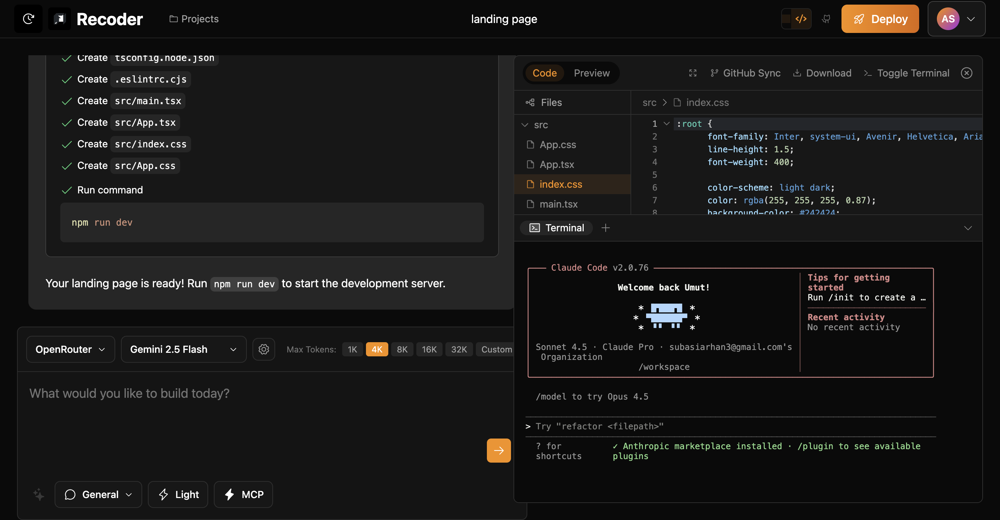

# 🎯 Recoder.xyz - Technical Status & Competitor Analysis

**Last Updated**: January 8, 2026
**Goal**: Feature parity with Replit, Cursor, and Bolt.new + Terminal CLI Integration

---

## 🚨 CRITICAL PRIORITIES (This Week)

### 1. Terminal System Broken
**Problem**: Terminals are stuck/unusable - can't open fresh terminal sessions.

**Current Issues**:
- Terminal 1 shows "Waiting for project initialization..." then disconnects repeatedly
- Terminal 2 shows dev server logs (Vite output) - should be in background
- Terminal 3 opens same as Terminal 2 - not a fresh shell
- Users can't get clean terminal to run commands
- Dev server output clutters terminal instead of running in background

**Required Fixes**:
- Each new terminal should open fresh bash/zsh shell
- Dev server should run in background (detached process)
- Terminal tabs should be independent sessions
- Fix WebSocket reconnection loop causing disconnects
- Add "Clear Terminal" and "Kill Process" buttons
- Show dev server logs in separate "Logs" panel, not terminal

### 2. Error Detection & Auto-Fix Loop
**Problem**: When AI generates code with errors that block `npm run dev`, users see blank preview with no clear way to fix.

**Required Features**:
- Detect build/runtime errors from dev server logs
- Show errors prominently in UI (error panel at top of preview)
- "Fix Errors" button that sends errors + code context back to AI
- AI automatically fixes and regenerates problematic files
- Retry dev server after fixes applied
- Loop until errors resolved or max retries reached

**Implementation**:
- Parse stderr/stdout from dev server for error patterns
- Extract file paths, line numbers, error messages
- Create error panel component above preview iframe
- Add "Fix with AI" button that triggers error fix flow
- Send error context to AI with instruction to fix
- Apply fixes and restart dev server automatically

### 3. File-Level Error Indicators
**Problem**: Users don't see which files have errors - no red underlines or error markers in file tree.

**Required Features**:
- Show error count badge on files with problems
- Red underline/highlight in Monaco editor for errors
- Error list panel showing all errors across files
- Click error to jump to file + line
- Real-time error detection as user types
- TypeScript/ESLint integration for static analysis

**Implementation**:
- Integrate Monaco's built-in diagnostics system
- Add TypeScript language server for type checking
- Parse build errors and map to file paths
- Update file tree to show error badges
- Create error list panel component
- Add click handlers to navigate to errors

---

## ✅ What We Have (MVP)

### Working Features
- File creation and editing with Monaco editor
- Live preview using Docker containers with HTTP proxy
- Terminal access via WebSocket PTY
- AI chat integration (Claude, OpenRouter, Groq)
- Project creation from starter templates
- Chat history stored in PostgreSQL
- Authentication via Better Auth
- **Claude Code CLI works** - users can run `claude` command in terminal
- **Need to add**: recoder-code CLI integration in terminal

### Infrastructure
- Docker backend running on port 3100 for container orchestration
- Next.js frontend on port 5173
- Neon PostgreSQL database for persistence
- WebSocket connections for terminal interaction
- HTTP proxy system for live preview

---

## 🖥️ Terminal CLI Integration (Critical Priority)

### Overview
Users need to be able to use industry-standard terminal CLIs directly within our web platform, with live preview integration. This is a major competitive advantage that combines the power of terminal-based AI tools with our visual interface.

### Claude Code Integration

**Why This Matters**: Claude Code from Anthropic is the most popular AI development CLI. It has over 5 million users and generates $40M+ ARR. Launched in 2025, it's powered by Sonnet 4.5 and includes features like automatic checkpointing, VS Code integration, and Slack integration. Users want Claude Code but need visual feedback - we provide that.

**Technical Approach**:
- Users sign in to their Anthropic accounts directly from recoder.xyz terminal with claude commands 
- Claude Code CLI runs inside the Docker container terminal
- All terminal output is captured in real-time via our WebSocket PTY
- When Claude Code makes file changes, our file watcher detects them
- Live preview automatically refreshes to show Claude Code's work
- Users see both the terminal conversation with Claude AND the visual results

6. Live preview shows results in real-time as Claude writes code
7. User can switch between terminal and visual editing seamlessly

### Recoder-Code Integration

**What It Is**: Our existing terminal CLI (v2.4.5 on npm) that needs platform integration. Currently works standalone with 40+ AI models. We need to connect it to recoder-web for bidirectional sync and live preview.

**Current Features** (already built):
- Published on npm as recoder-code v2.4.5
- Supports 40+ AI models via OpenRouter (Claude, GPT-4, Gemini, DeepSeek, Qwen3)
- Tool calling and agentic workflows with 17 MCP servers
- Interactive terminal UI with file operations
- Sandbox mode (Docker/macOS isolation)
- Image generation, PDF analysis, audio support
- Cost optimization with prompt caching

**What We Need to Add**:

Platform Integration:
- WebSocket connection to recoder-web backend
- Bidirectional file sync with web editor
- Project association between CLI and web
- Shared chat history across CLI and web interfaces
- Live preview URL display when running in platform
- Container detection (running local vs in our Docker containers)
- Session persistence across platforms

**User Flow**:
1. User installs via "npm install -g recoder-code" (already available)
2. Links API keys (Claude, OpenAI, Groq, Gemini) via existing setup wizard
3. NEW: Connects to recoder.xyz account for project sync
4. NEW: Can work on projects locally or in platform containers
5. NEW: Changes made in CLI sync to web editor in real-time
6. NEW: Live preview automatically reflects CLI changes

**Integration Requirements**:
- Add recoder.xyz account authentication to CLI
- Build WebSocket client for real-time sync
- Implement file watcher that pushes to platform
- Pull platform changes to local CLI session
- Display live preview URL in CLI when connected
- Support offline mode (CLI works without platform)

## 🔧 Technical Implementation Plan

### Priority 0: Terminal CLI Integration (Weeks 1-3)

**Phase 1 - Claude Code Integration**:

Install Claude Code CLI in Docker container base images. Update Dockerfile to include latest Claude Code NPM package. Configure environment variables for Anthropic API access. Test CLI functionality inside containers.

Implement real-time file watching system. Use chokidar or similar to watch all files in container. Detect changes made by Claude Code. Trigger file list refresh in frontend. Update Monaco editor content if file is open. Refresh live preview automatically.

Build terminal session persistence. Store Claude Code session state in Redis. Restore conversations when container restarts. Link terminal sessions to user accounts. Implement session timeout handling.

**Phase 2 - Recoder-Code Platform Integration**:

Add recoder.xyz authentication to existing CLI. Implement account login flow. Store authentication tokens securely. Handle token refresh and expiration. Support logout and account switching.

Build WebSocket client for platform communication. Connect to recoder-web backend. Implement reconnection logic. Handle connection state changes. Show connection status in CLI.

Implement bidirectional file sync protocol. Watch local file changes and push to platform. Pull remote changes from web editor. Handle conflict resolution with user prompts. Maintain sync state and history. Queue changes during offline mode.

Add project association and management. Link CLI sessions to web projects. Create projects from CLI. List and switch between projects. Display live preview URLs. Sync chat history across platforms.

Implement Ollama integration for local AI. Add Ollama provider to recoder-code. Support model download and management. Detect available local models. Enable offline AI development. Fallback to cloud when local models unavailable. Show model source (local vs cloud) in UI.

### Priority 1: Multi-File Editing (Week 4)

**Goal**: Match Replit's editor tabs system.

Create editor state management using nanostores. Design store to track array of open files with path, content, modified flag, and Monaco instance. Implement functions to open file, close file, switch active file, save file, and save all files.

Build tab bar UI component. Show all open files as tabs. Highlight active tab. Display modified indicator (dot). Add close button per tab. Implement drag-to-reorder. Support tab overflow scrolling.

Add keyboard shortcuts. Command+W to close active tab. Command+Tab to switch tabs. Command+S to save active file. Command+Shift+S to save all files. Command+1 through Command+9 for tab navigation.

Optimize Monaco editor instances. Reuse editor instances when switching tabs. Only change the model, don't recreate editor. Dispose unused models to free memory. Lazy load language support.

### Priority 2: Advanced File Tree (Week 5)

**Goal**: Match Replit's file explorer with full folder management.

Design file tree data structure. Create recursive tree with files and folders. Track expanded state for folders. Support lazy loading for large directories. Implement path-based lookups.

Build folder operations API. Create endpoint for creating folders. Add rename endpoint supporting files and folders. Implement delete with confirmation for folders. Add move/copy operations.

Implement drag-and-drop. Make files and folders draggable. Show drop zones when dragging. Execute move operation on drop. Show visual feedback during drag. Handle drag to different folders.

Add context menu system. Right-click on file or folder shows menu. Options: rename, delete, copy path, reveal in terminal. Different menus for files vs folders. Support keyboard shortcuts for menu actions.

Create file search functionality. Implement fuzzy search like Command+P in VS Code. Search across all file paths. Show results with highlighting. Navigate with keyboard arrows. Open file on Enter.

### Priority 3: Container Resource Management (Week 6)

**Goal**: Prevent resource exhaustion and reduce infrastructure costs.

Implement container lifecycle tracking. Create map of active containers with metadata. Track last activity timestamp. Record resource usage metrics. Store container-to-project mapping.

Add resource limits to container creation. Set memory limit to 512MB per container. Limit CPU to 1 core. Set max process limit to 100. Configure disk quota. Add network bandwidth limits.

Build automated cleanup system. Use node-cron to run cleanup every hour. Find containers inactive for 24+ hours. Stop and remove inactive containers. Free up ports and resources. Log cleanup operations.

Create manual cleanup controls. Add admin endpoint to force cleanup. Build UI for viewing active containers. Show resource usage per container. Allow manual stop/restart. Display cleanup logs.

Implement container health checks. Ping container every 5 minutes. Check if processes are running. Verify network connectivity. Auto-restart unhealthy containers. Alert on repeated failures.

### Priority 4: AI Code Generation (Week 7-8)

**Goal**: Match Bolt.new's full-stack generation from natural language.

Design code generation prompt system. Create specialized system prompts for different frameworks. Include rules for complete, working code. Specify file structure requirements. Add best practices and patterns.

Build generation API endpoint. Accept natural language description. Route to appropriate AI model (Claude Sonnet 4.5 for complex apps). Stream generation progress. Return structured file list with content.

Implement multi-file creation. Parse AI response into file objects. Create all files in container simultaneously. Handle directory creation. Set proper file permissions. Validate file contents.

Add auto-dependency installation. Detect package.json in generated files. Run npm install automatically. Show installation progress. Handle installation errors. Restart preview after install.

Create generation UI. Add prominent "Generate App" button. Show input modal for description. Display streaming progress indicator. Show created files list. Auto-open main file in editor.

Implement iteration support. Allow user to request modifications. Maintain context from initial generation. Support "add feature X" follow-ups. Track generation history. Enable rollback to previous versions.

### Priority 6: Package Management UI (Week 11)

**Goal**: Visual package installation like Replit, no manual package.json editing.

Build package search interface. Create search input with debouncing. Query npm registry API. Parse and display search results. Show package name, version, description. Display download stats and popularity.

Implement package installation. Add install button per search result. Run npm install in container via terminal API. Stream installation output to UI. Update package.json file tree. Refresh dependencies list.

Create installed packages view. Parse package.json to show installed packages. Display current versions. Show if updates available. Add uninstall button. Link to package documentation.

Add dependency detection. Scan code for import statements. Detect missing packages. Show suggestions to install. One-click install from suggestions. Auto-install on file save.

Implement version management. Show version dropdown for each package. Support installing specific versions. Display changelog between versions. Handle breaking changes warnings. Support version pinning.

### Priority 7: Deployment Integration (Week 12-13)

**Goal**: One-click deployment to Vercel, Railway, and Netlify.

Build Vercel deployment integration. Implement Vercel API authentication. Create deployment from project files. Configure framework detection. Handle environment variables. Return deployment URL and status.

Add Railway deployment. Integrate Railway API. Support Docker deployments. Configure database connections. Set up domain management. Handle deployment logs.

Implement Netlify deployment. Use Netlify API for static sites. Configure build commands. Handle redirects and headers. Set up form handling. Support serverless functions.

Create deployment UI. Add deploy button in header. Show deployment configuration modal. Display deployment progress. Show build logs in real-time. Display deployed URL prominently.

Add environment variable management. Create UI for env var configuration. Store encrypted in database. Inject into deployments. Support per-environment variables. Validate required variables.

Implement deployment history. Track all deployments per project. Show deployment status and timestamps. Support rollback to previous deployments. Display deployment differences. Link to live URLs.

### Priority 8: Git Integration (Week 14-15)

**Goal**: Match Cursor's Git features with commit, push, diff, and branches.

Install Git in containers. Update Docker images with Git CLI. Configure default Git user. Initialize repository on project creation. Create initial commit automatically.

Build commit interface. Show changed files list. Display diff for each file. Add commit message input. Implement staged changes UI. Support partial file staging.

Create GitHub integration. Implement GitHub OAuth for repository access. Link existing repositories. Create new repositories from UI. Configure push/pull permissions. Handle SSH key management.

Implement diff viewer. Show side-by-side or unified diff. Syntax highlight diff content. Support inline comments. Show line numbers. Handle binary files gracefully.

Add branch management. Display current branch. Show branch list with switcher. Create new branches from UI. Support branch deletion. Handle merge conflicts. Display branch graph.

Build pull request creation. Generate PR from current branch. Pre-fill title from commits. Auto-generate description. Link to GitHub PR. Show PR status in UI.

### Priority 9: AI Code Intelligence (Week 16-17)

**Goal**: Match Cursor's inline AI with suggestions, explanations, and fixes.

Implement inline code suggestions. Capture cursor position and surrounding code. Send context to Claude API. Generate next-line suggestions. Display as ghost text in editor. Accept with Tab key.

Add keyboard command for AI assistance. Bind Command+I to AI prompt. Show inline input for user request. Send selected code as context. Stream AI response. Apply changes to editor.

Create "Explain Code" feature. Right-click on code shows explain option. Send code to AI with explanation prompt. Display explanation in sidebar panel. Support follow-up questions. Link to relevant documentation.

Implement "Fix with AI" for errors. Detect TypeScript/ESLint errors. Show fix button in error popup. Send error and code to AI. Apply suggested fix automatically. Support undo if fix incorrect.

Add test generation. Right-click function shows "Generate Tests". Send function code to AI with test framework context. Create test file automatically. Import necessary testing libraries. Run tests to verify.

Build refactoring suggestions. Detect code smells and anti-patterns. Show refactoring suggestions. Preview refactoring changes. Apply with one click. Support multiple refactoring options.

---

**Note on Terminal CLI**: recoder-code v2.4.5 is already published on npm with 40+ AI models, tool calling, and MCP servers. What's missing is the platform integration (sync with recoder-web, live preview connection, shared sessions).

---

## 🔨 Critical Technical Debt

### Immediate
- Remove all console.log statements from production code
- Add proper React error boundaries for graceful failures
- Implement retry logic with exponential backoff for API calls
- Add loading states throughout UI without emoji decorations

### Short-term
- Optimize bundle size from 4.8MB down to under 2MB 
- Implement service worker for offline capability
- Lazy load Monaco language definitions to reduce initial load
- Add database query optimization and connection pooling
- Implement request debouncing for file operations
- Add proper TypeScript types throughout codebase

### Long-term
- Replace in-memory session storage with Redis cluster
- Implement container pooling with pre-warmed instances
- Set up multi-region deployment for global users
- Configure CDN for static assets and images
- Build horizontal scaling for WebSocket servers
- Implement database sharding for large user base

---

🔍 Deep Project Analysis: Recoder.xyz

  Executive Summary

  Recoder.xyz is an ambitious AI-powered development platform that aims to compete with Replit, Cursor, and Bolt.new. It consists of 6 major components working together:

  | Component         | Technology           | Purpose                                        |
  |-------------------|----------------------|------------------------------------------------|
  | docker-backend    | Express + Docker API | Real code execution in isolated containers     |
  | app               | Next.js 15           | Marketing site + User dashboard + Auth         |
  | recoder-web       | Remix + WebContainer | Browser-based IDE (Bolt.new competitor)        |
  | recoder-code CLI  | Ink/React            | Terminal AI assistant (Claude Code competitor) |
  | recoder-code core | TypeScript library   | AI orchestration + tools + subagents           |
  | Neon PostgreSQL   | Serverless DB        | Persistence layer                              |

  ---
  🏗️ Architecture Overview

  ┌─────────────────────────────────────────────────────────────────┐
  │                         USER INTERFACES                          │
  ├──────────────────┬─────────────────────┬────────────────────────┤
  │  recoder-web     │     app (Next.js)   │   recoder-code CLI     │
  │  (Remix/CF)      │  Marketing+Auth     │   (Terminal AI)        │
  │  Browser IDE     │  Billing+Dashboard  │   108K+ lines          │
  │  57 routes       │  50+ pages          │   77 hooks             │
  │  WebContainer    │  Better Auth        │   50+ commands         │
  ├──────────────────┴─────────────────────┴────────────────────────┤
  │                           API LAYER                              │
  ├─────────────────────────────────────────────────────────────────┤
  │  docker-backend (Port 3100)     │   recoder-code-core           │
  │  • Container orchestration      │   • AI provider abstraction    │
  │  • Real terminal (PTY)          │   • Tool system (17 tools)     │
  │  • Live preview proxy           │   • Subagent framework         │
  │  • Multi-language (8 langs)     │   • MCP integration            │
  │  • File operations              │   • IDE integration            │
  ├─────────────────────────────────┴───────────────────────────────┤
  │                      INFRASTRUCTURE                              │
  ├─────────────────────────────────────────────────────────────────┤
  │  • Docker containers (recoder-universal:latest)                  │
  │  • Neon PostgreSQL (serverless)                                 │
  │  • Redis (sessions/cache)                                        │
  │  • Cloudflare Pages (recoder-web)                               │
  │  • Vercel (app)                                                  │
  └─────────────────────────────────────────────────────────────────┘

  ---
  🎯 Key Insights by Component

  1. docker-backend (Real Execution Engine)

  What It Does: Provides REAL code execution (not sandboxed mocks) via Docker containers.

  Critical Features:
  - Multi-language support: Node.js, Python, Rust, Go, Java, Ruby, PHP, Bun
  - WebSocket PTY for real terminal access
  - HTTP proxy for live dev server preview
  - Port management (10000-20000 range)
  - Container lifecycle with auto-cleanup

  Architecture Quality: Production-grade with race condition handling, health checks, and resource limits.

  2. app (Business Website)

  What It Does: Marketing, authentication, billing, and user management.

  Critical Features:
  - Better Auth + NextAuth for OAuth (GitHub, Google)
  - BYOK (Bring Your Own Key) - users provide API keys
  - 40+ AI model support via OpenRouter
  - Paddle + DodoPay for billing
  - AES-256-GCM encrypted API keys
  - Prisma ORM with comprehensive schema

  Business Model: Free tier with BYOK, optional premium for platform keys.

  3. recoder-web (Browser IDE)

  What It Does: Full development environment in browser (Bolt.new competitor).

  Critical Features:
  - WebContainer API for in-browser Node.js runtime
  - 45+ starter templates (React, Vue, Next.js, etc.)
  - Multi-model AI routing (Grok, Claude, Gemini, OpenAI)
  - GitHub deep integration (clone, push, sync)
  - Live preview with HMR
  - MCP server support
  - Real-time streaming chat

  Tech Stack: Remix + Cloudflare Pages + UnoCSS + Nanostores

  4. recoder-code CLI (Terminal AI)

  What It Does: Standalone terminal AI assistant (like Claude Code).

  Critical Features:
  - 108,050 lines of code - enterprise-grade
  - 77 React hooks for state management
  - 50+ slash commands (built-in + extensible)
  - Interactive UI via Ink (React for terminals)
  - Vim mode support
  - Sandbox execution (macOS profiles)
  - Extension system (custom commands)
  - MCP prompt integration

  Architecture: Service-oriented with CommandService, RecoderAIService, BuiltinCommandLoader.

  5. recoder-code-core (AI Foundation)

  What It Does: Core library powering all AI interactions.

  Critical Features:
  - 186 TypeScript source files
  - Multi-provider abstraction (Gemini, OpenAI, OpenRouter)
  - 17 built-in tools (read, write, edit, shell, grep, web fetch)
  - Subagent system - create custom AI agents
  - Tool registry with confirmation system
  - IDE integration (VS Code)
  - MCP client with OAuth PKCE
  - Streaming pipelines
  - Telemetry via OpenTelemetry

  ---
  