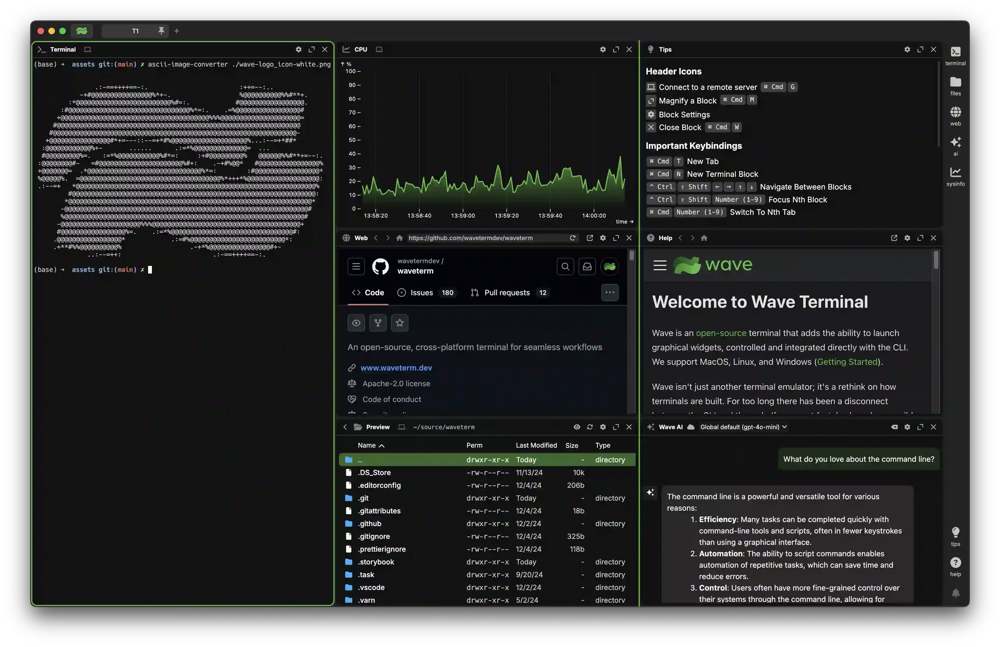

import { Card, CardGroup } from "@site/src/components/card";

# Welcome to Recoder Terminal

Recoder Terminal is an open-source terminal that combines traditional terminal features with graphical capabilities like file previews, web browsing, and AI assistance. It runs on MacOS, Linux, and Windows.

Modern development involves constantly switching between terminals and browsers - checking documentation, previewing files, monitoring systems, and using AI tools. Recoder Terminal brings these graphical tools directly into the terminal, letting you control them from the command line. This means you can stay in your terminal workflow while still having access to the visual interfaces you need.

Check out [Getting Started](./gettingstarted) for installation instructions.

<CardGroup>
  <Card
    href="./waveai"
    icon="fa-sparkles"
    title="Recoder AI"
    description="Context-aware terminal assistant with access to terminal output, widgets, and filesystem."
  />
  <Card
    href="./customization"
    icon="fa-paintbrush"
    title="Customization"
    description="Set up tabs and terminals to match your workflow needs."
  />
  <Card
    href="./keybindings"
    icon="fa-keyboard"
    title="Key Bindings"
    description="Boost efficiency with keyboard shortcuts for faster navigation."
  />
  <Card
    href="./layout"
    icon="fa-grid-2"
    title="Layout"
    description="Organize your workspace using our layout system."
  />
  <Card
    href="./connections"
    icon="fa-network-wired"
    title="Remote Connections"
    description="Quickly SSH or connect to remote machines in one step."
  />
  <Card
    href="./widgets"
    icon="fa-rocket"
    title="Widgets"
    description="Explore built-in tools to extend your terminal’s functionality."
  />
  <Card
    href="./wsh"
    icon="fa-rectangle-terminal"
    title="wsh Command"
    description="Control Recoder Terminal and launch widgets directly from the command line."
  />
</CardGroup>

:::info

If you have a question or would like to file a bug or enhancement request, please use GitHub Issues on the Recoder repository. These docs are also open-source, and doc PRs are welcome.

:::

Other References:

- [Configuration](./config)
- [Custom Widgets](./customwidgets)
- [Full wsh reference](./wsh-reference)
- [Telemetry](./telemetry)
- [FAQ](./faq)
- [Release Notes](./releasenotes)

## Links

- **Homepage** https://recoder.xyz
