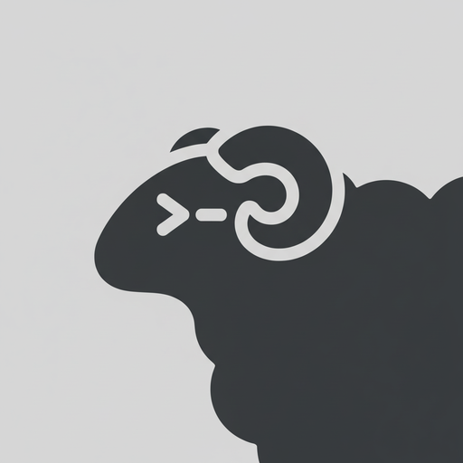

# loom


<p align="center">
  
</p>

<p align="center">
  <a href="https://loom.dev">loom.dev</a> · <a href="#install">install</a> · <a href="https://loom.dev/docs/quick-start/">quick start</a> · <a href="https://loom.dev/docs/">docs</a>
</p>

<p align="center">
  English · <a href="README.zh-CN.md">简体中文</a>
</p>

<p align="center">
  <a href="LICENSE"></a>
  <a href="https://github.com/loomdev/loom/releases"></a>
  <a href="https://github.com/loomdev/loom/stargazers"></a>
  <a href="https://github.com/loomdev/loom/releases/latest"></a>
  <a href="https://formulae.brew.sh/formula/loom"></a>
  <a href="https://x.com/loomdev"></a>
</p>

---

https://github.com/user-attachments/assets/043ec09f-4bdd-41d5-aee0-8fda6b83e267

**the runtime your coding agents live on.**

- **always running** — loom is a background server; the terminals live inside it. close the lid, drop the network, or restart the machine; agents keep working and sessions come back. reattach from any terminal, or over ssh.
- **never hunt for the stuck one** — every pane is marked working, blocked, or idle. when an agent stops and needs an answer, loom says so.
- **agent-native** — agents drive loom through the cli and socket api: they can spawn panes, prompt each other, and wait until another agent is genuinely blocked. [agent skill →](https://loom.dev/docs/agent-skill/)
- **runs what you already run** — claude code, codex, cursor, opencode, grok and the rest. loom doesn't wrap or replace them; it owns their terminals.
- **keyboard and mouse, both first-class** — tmux-style prefix keys *and* click, drag, split. pick per moment, not per tool.
- **plugins** — extend panes and workflows. [browse the marketplace →](https://loom.dev/plugins/)
- **one rust binary, no electron** — runs in whatever terminal you already use.

---

## install

```bash
curl -fsSL https://loom.dev/install.sh | sh
```

or `brew install loom` · `mise use -g loom` · windows beta: `powershell -ExecutionPolicy Bypass -c "irm https://loom.dev/install.ps1 | iex"` · [binaries](https://github.com/loomdev/loom/releases)

then start it where the work lives:

```bash
loom
```

run your agents, split panes, walk away. `ctrl+b q` detaches, `loom` reattaches. [quick start →](https://loom.dev/docs/quick-start/)

## docs

everything lives at [loom.dev/docs](https://loom.dev/docs/): [quick start](https://loom.dev/docs/quick-start/) · [concepts](https://loom.dev/docs/concepts/) · [supported agents](https://loom.dev/docs/agents/) · [keyboard](https://loom.dev/docs/keyboard/) · [configuration](https://loom.dev/docs/configuration/) · [session state](https://loom.dev/docs/session-state/) · [remote](https://loom.dev/docs/persistence-remote/) · [integrations](https://loom.dev/docs/integrations/) · [plugins](https://loom.dev/docs/plugins/) · [socket api](https://loom.dev/docs/socket-api/)

## thanks

every past sponsor and backer is listed in [SPONSORS.md](./SPONSORS.md) — thank you 🐑

enterprise / partnership: hey@loom.dev

## agent instructions

if you are an ai agent helping with this repository, read [`AGENTS.md`](./AGENTS.md) before making changes and read [`CONTRIBUTING.md`](./CONTRIBUTING.md) before opening issues or PRs.

## development

```bash
git clone https://github.com/loomdev/loom
cd loom
cargo build --release

just test        # unit tests
just check       # formatting, tests, and maintenance checks
```

## license

Loom is licensed under the [Apache License 2.0](LICENSE).
