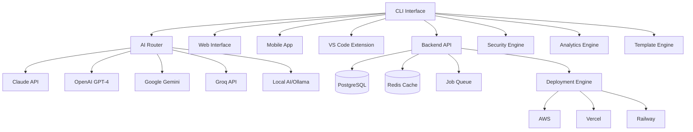
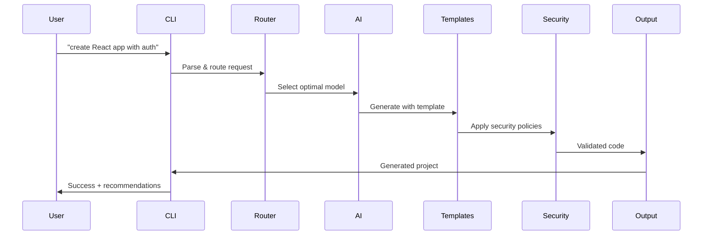
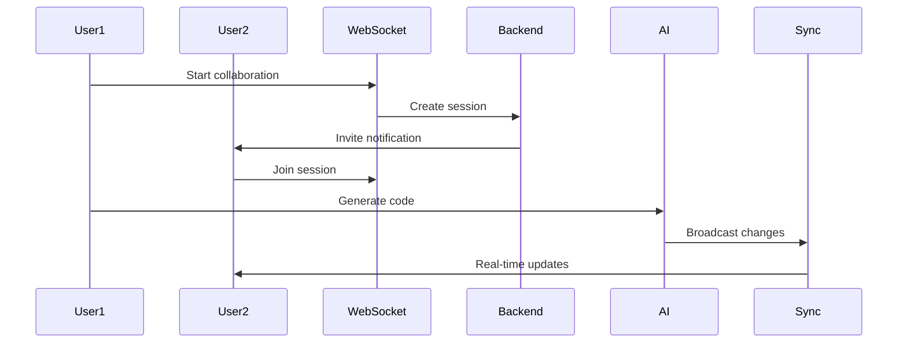

# Recoder.xyz Architecture Guide

This document provides a comprehensive overview of Recoder.xyz's architecture, designed for developers who want to understand how the system works under the hood.

## 🏗️ High-Level Architecture

Recoder.xyz is built as a distributed, AI-powered development ecosystem with the following core principles:

- **Local-First**: Minimize dependencies on external services
- **AI-Native**: Built from the ground up for AI-powered code generation
- **Production-Ready**: Every component is designed for enterprise use
- **Modular**: Loosely coupled services that can scale independently
- **Secure**: Security and compliance built into every layer



## 🎯 Core Components

### 1. CLI Interface (`packages/cli/`)

The primary interface for developers, built with TypeScript and Commander.js.

**Key Features:**
- Natural language command processing
- Interactive project generation
- Real-time AI assistance
- Local development workflow integration

**Architecture:**
```typescript
CLI Core
├── Command Parser (Commander.js)
├── Natural Language Processor
├── AI Router Integration
├── Project Manager
└── Output Formatter
```

**Example Flow:**
```bash
recoder "add authentication to my React app"
│
├── Parse natural language intent
├── Identify project context
├── Route to appropriate AI model
├── Generate authentication code
├── Apply security best practices
└── Update project files
```

### 2. AI Router (`packages/recoder-cli-router/`)

Intelligent routing system that selects the optimal AI model for each task.

**Decision Matrix:**
```typescript
interface RouteDecision {
  task: TaskType;
  complexity: 'simple' | 'medium' | 'complex';
  context: ProjectContext;
  userPreferences: UserPreferences;
  costOptimization: boolean;
  availableModels: AIProvider[];
}

const routingRules = {
  codeGeneration: {
    simple: ['groq', 'gpt-4'],
    medium: ['claude', 'gpt-4'],
    complex: ['claude', 'gemini']
  },
  architecture: {
    all: ['claude', 'gpt-4']
  },
  blockchain: {
    all: ['claude', 'gpt-4']
  },
  security: {
    all: ['claude']
  }
};
```

**Performance Optimization:**
- Request caching with semantic similarity
- Model warming for frequently used models
- Fallback chains for reliability
- Cost-aware routing

### 3. Backend API (`backend/`)

Express.js-based API server handling user management, project storage, and orchestration.

**Services:**
```typescript
Backend Services
├── Authentication Service (JWT + OAuth)
├── Project Management Service
├── User Analytics Service
├── Billing & Usage Tracking
├── Collaboration Service
├── File Storage Service
└── Notification Service
```

**Database Schema:**
```sql
-- Core entities
Users (id, email, subscription, preferences)
Projects (id, user_id, name, type, config)
Generations (id, project_id, prompt, result, model_used)
Collaborations (id, project_id, participants, status)
Analytics (id, user_id, action, metadata, timestamp)
```

### 4. Template Engine (`packages/cli/src/generators/`)

Advanced code generation system with AI-powered customization.

**Template Categories:**
- **Frontend**: React, Next.js, Vue, Svelte
- **Backend**: Express, Fastify, NestJS
- **Mobile**: React Native, Flutter
- **Desktop**: Electron, Tauri
- **Blockchain**: Solana, Ethereum, Polygon
- **AI**: LangChain, Custom agents

**Template Structure:**
```typescript
interface Template {
  id: string;
  name: string;
  category: TemplateCategory;
  framework: string;
  language: string;
  complexity: ComplexityLevel;
  files: TemplateFile[];
  dependencies: Dependency[];
  features: Feature[];
  aiOptimized: boolean;
}
```

### 5. Security Engine (`recoder-chat/lib/security/`)

Enterprise-grade security and compliance system.

**Security Layers:**
```typescript
Security Stack
├── Input Validation & Sanitization
├── Authentication & Authorization
├── Rate Limiting & DDoS Protection
├── Data Encryption (AES-256)
├── Audit Logging & Monitoring
├── Compliance Checks (SOC2, GDPR, HIPAA)
└── Incident Response System
```

**Compliance Features:**
- **SOC 2**: Access controls, system monitoring, data protection
- **GDPR**: Data privacy, right to erasure, consent management
- **HIPAA**: Healthcare data protection, audit trails
- **ISO 27001**: Information security management

### 6. Analytics Engine (`recoder-chat/lib/monitoring/`)

Comprehensive monitoring and analytics system for performance optimization.

**Metrics Collected:**
```typescript
Analytics Domains
├── User Behavior
│   ├── Command usage patterns
│   ├── Feature adoption rates
│   ├── Session duration & frequency
│   └── Error rates & user flows
├── AI Performance
│   ├── Model response times
│   ├── Success/failure rates
│   ├── Cost per request
│   └── Cache hit rates
├── System Health
│   ├── CPU, memory, storage usage
│   ├── Network performance
│   ├── Database query times
│   └── Service availability
└── Business Metrics
    ├── Revenue & subscription data
    ├── Customer acquisition cost
    ├── Retention rates
    └── Feature value analysis
```

## 🔄 Data Flow

### 1. Code Generation Flow



### 2. Real-time Collaboration Flow



## 🚀 Deployment Architecture

### Production Infrastructure

```yaml
Infrastructure Stack:
  Load Balancer: 
    - CloudFlare (DDoS protection, CDN)
    - Health checks & failover
  
  Application Layer:
    - Kubernetes cluster (auto-scaling)
    - Multiple regions (US, EU, Asia)
    - Blue-green deployments
  
  Data Layer:
    - PostgreSQL (primary data)
    - Redis (caching & sessions)
    - S3 (file storage)
    - ElasticSearch (search & analytics)
  
  Monitoring:
    - Prometheus (metrics)
    - Grafana (dashboards)
    - Sentry (error tracking)
    - DataDog (APM)
```

### Scaling Strategy

**Horizontal Scaling:**
- CLI instances: Stateless, can scale infinitely
- API servers: Load balanced across multiple instances
- AI routing: Distributed across regions
- Database: Read replicas + sharding strategy

**Vertical Scaling:**
- High-memory instances for AI processing
- SSD storage for fast I/O operations
- Dedicated GPU instances for local AI models

### Deployment Pipeline

```yaml
CI/CD Pipeline:
  1. Code Commit (GitHub)
  2. Automated Testing
     - Unit tests (Jest)
     - Integration tests
     - Security scans
     - Performance tests
  3. Build & Package
     - Docker containers
     - Multi-architecture builds
     - Dependency optimization
  4. Staging Deployment
     - Automated deployment
     - Smoke tests
     - Performance validation
  5. Production Deployment
     - Blue-green deployment
     - Health checks
     - Rollback capability
  6. Post-deployment
     - Monitoring alerts
     - Performance metrics
     - User impact analysis
```

## 🔒 Security Architecture

### Defense in Depth

```typescript
Security Layers:
├── Network Security
│   ├── WAF (Web Application Firewall)
│   ├── DDoS Protection
│   ├── Rate Limiting
│   └── IP Filtering
├── Application Security
│   ├── Input Validation
│   ├── Authentication (JWT + OAuth)
│   ├── Authorization (RBAC)
│   └── Session Management
├── Data Security
│   ├── Encryption at Rest (AES-256)
│   ├── Encryption in Transit (TLS 1.3)
│   ├── Key Management (HSM)
│   └── Data Anonymization
└── Infrastructure Security
    ├── Container Scanning
    ├── Vulnerability Management
    ├── Patch Management
    └── Incident Response
```

### Zero Trust Architecture

Every request is verified, regardless of source:

1. **Identity Verification**: Multi-factor authentication
2. **Device Compliance**: Device health checks
3. **Least Privilege**: Minimal access rights
4. **Continuous Monitoring**: Real-time threat detection

## 📊 Performance Optimization

### Caching Strategy

```typescript
Cache Hierarchy:
├── Browser Cache (static assets)
├── CDN Cache (global distribution)
├── Application Cache (Redis)
│   ├── AI response cache
│   ├── Template cache
│   ├── User session cache
│   └── Database query cache
└── Database Cache (query optimization)
```

### AI Performance Optimization

**Model Selection:**
- Task-specific model routing
- Performance vs. cost optimization
- Real-time model switching

**Request Optimization:**
- Semantic caching for similar requests
- Batch processing for multiple operations
- Streaming responses for large outputs

**Local AI Integration:**
- Ollama for privacy-sensitive tasks
- Model quantization for faster inference
- GPU acceleration where available

## 🔧 Development Workflow

### Local Development Setup

```bash
# 1. Clone repository
git clone https://github.com/recoder-xyz/recoder.git
cd recoder

# 2. Install dependencies
npm run setup

# 3. Configure environment
cp .env.example .env
# Add API keys for AI providers

# 4. Start development servers
npm run dev:all
```

### Code Organization

```
recoder.xyz/
├── packages/
│   ├── cli/                 # Main CLI package
│   ├── shared/              # Shared utilities
│   ├── recoder-cli-router/  # AI routing system
│   ├── analytics/           # Analytics package
│   └── security/            # Security package
├── backend/                 # API server
├── production-engine/       # Code generation service
├── recoder-web/            # Web application
├── recoder-chat/           # Chat interface
├── recoder-mobile/         # Mobile app
├── deployment/             # Infrastructure code
└── docs/                   # Documentation
```

### Testing Strategy

```typescript
Testing Pyramid:
├── Unit Tests (70%)
│   ├── Jest for TypeScript/JavaScript
│   ├── PyTest for Python components
│   └── Mock external dependencies
├── Integration Tests (20%)
│   ├── API endpoint testing
│   ├── Database integration
│   └── AI model integration
└── End-to-End Tests (10%)
    ├── Playwright for web UI
    ├── CLI command testing
    └── Real user scenarios
```

## 🌐 Multi-Platform Architecture

### Platform-Specific Implementations

**CLI (Primary):**
- Node.js-based
- Cross-platform (Windows, macOS, Linux)
- Local AI integration
- Offline capabilities

**Web Interface:**
- Next.js application
- Real-time collaboration
- Browser-based AI
- Progressive Web App

**Mobile App:**
- React Native
- Native AI integration
- Offline synchronization
- Device sensor integration

**VS Code Extension:**
- TypeScript extension
- Inline AI assistance
- Project management
- Real-time collaboration

## 🔮 Future Architecture Plans

### Upcoming Features

**Enhanced AI Integration:**
- Multi-modal AI (text, image, code)
- Custom model fine-tuning
- Federated learning for privacy
- Real-time model updates

**Advanced Collaboration:**
- Voice-based coding sessions
- AI pair programming
- Automated code reviews
- Team workspace management

**Enterprise Features:**
- On-premises deployment
- Custom compliance frameworks
- Advanced analytics dashboard
- Integration marketplace

### Scalability Roadmap

**Short Term (6 months):**
- Multi-region deployment
- Advanced caching layer
- Performance optimization
- Mobile app launch

**Medium Term (12 months):**
- Microservices architecture
- Event-driven architecture
- Advanced AI routing
- Enterprise features

**Long Term (24 months):**
- Edge computing integration
- Quantum-resistant security
- AI model marketplace
- Global development platform

---

This architecture is designed to be **production-ready from day one** while maintaining the flexibility to evolve with changing requirements and new AI capabilities.

For implementation details of specific components, see the individual component documentation in their respective directories.