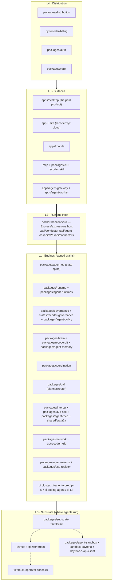
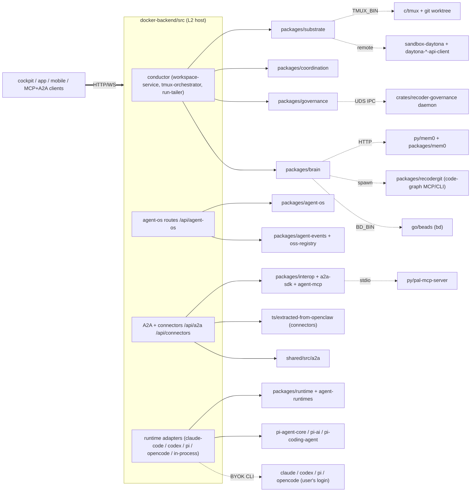
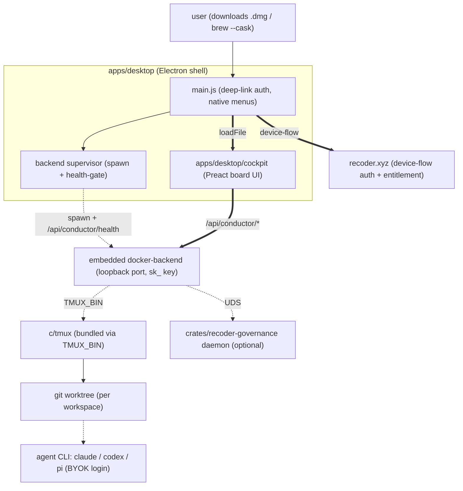
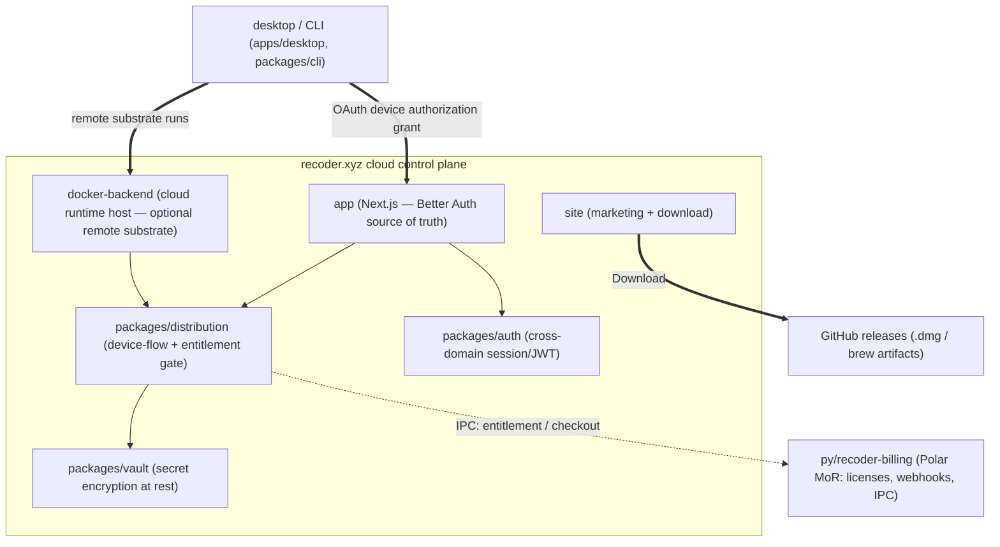
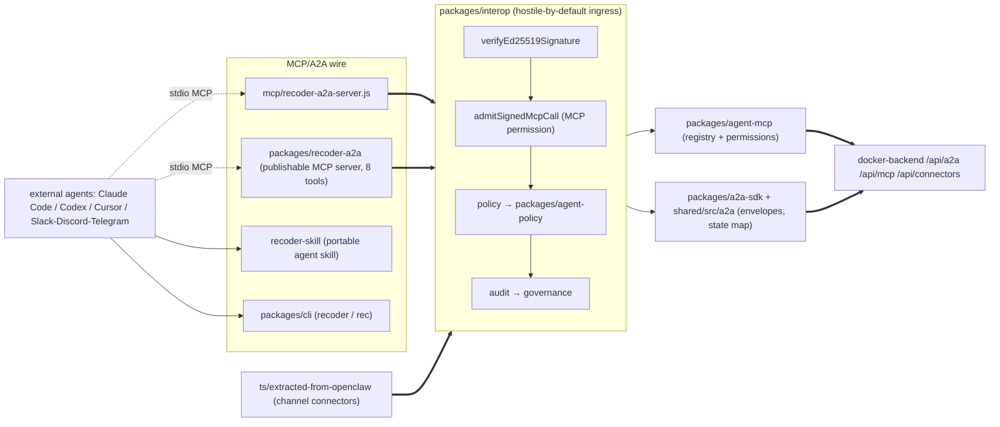
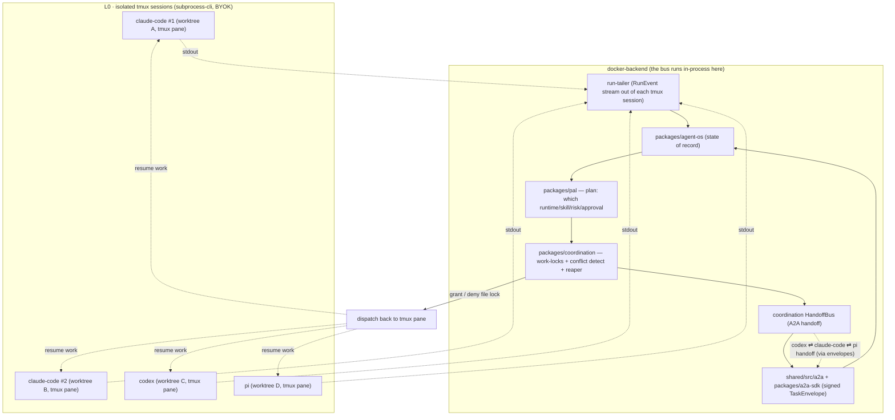
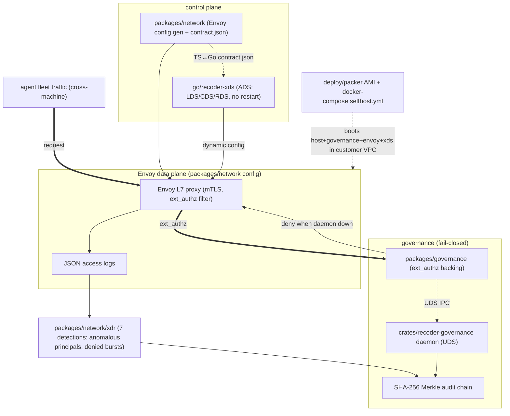
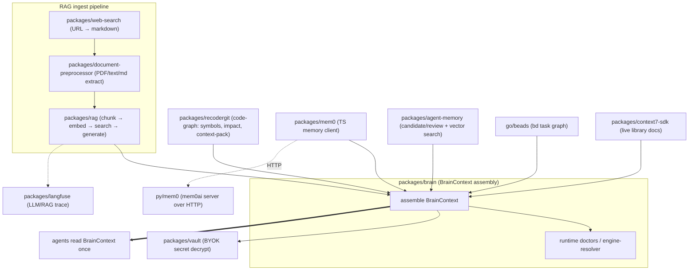
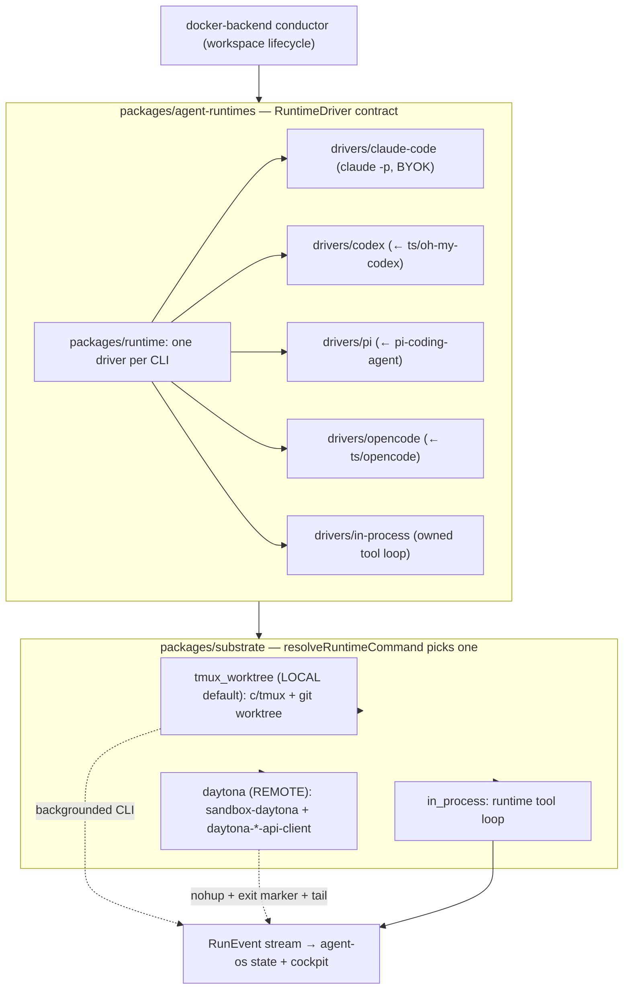

# Recoder — Architecture Diagrams

> A true map of the monorepo. Every node label below is a **real directory** from
> the inventory (see [`../DIRECTORY-MAP.md`](../DIRECTORY-MAP.md)). These diagrams
> are the visual companion to [`../ARCHITECTURE.md`](../ARCHITECTURE.md) (the L0→L4
> layering, BYOK, the swappable substrate, governance fail-closed, the Envoy/XDR/AMI
> spine) and [`../PRODUCTS.md`](../PRODUCTS.md) (the four shipping surfaces).
>
> Conventions used in the diagrams:
> - **solid arrow** = in-process import (`m: in-process-import`).
> - **dashed arrow** (`-.->`) = spawned subprocess / CLI (`m: subprocess-cli`) or an
>   IPC/UDS/HTTP hop.
> - **thick arrow** (`==>`) = an HTTP / WebSocket edge (`m: http-edge`).
> - Parked / provenance-only trees are shown with a `park` style where relevant.

---

## 1. System-of-systems — the five layers

The whole product is one stack in five layers: agents physically run on a **substrate**
(L0), owned **engines** (L1) supply the brains, a single **runtime host** `docker-backend`
(L2) mounts those engines and exposes the APIs, **surfaces** (L3) consume the host, and
**distribution** (L4) ships + gates it. Read top-to-bottom: each layer only depends on
the one above it, and `docker-backend` is the single waist every surface talks through.

---

## 2. Product SERVER internals — `docker-backend`

`docker-backend/src` is the L2 waist: it **imports the L1 engines in-process**, **spawns
heavier engines as CLIs/sidecars** (tmux, the agent CLIs, the Rust governance daemon, the
PAL/mem0 servers), and **exposes HTTP/WS edges** to every surface. This diagram shows the
three integration modes meeting in one process: solid = import, dashed = spawn/IPC, thick = HTTP/WS.

---

## 3. DESKTOP app — `apps/desktop` boots an embedded backend

The desktop product is an Electron shell that **supervises an embedded `docker-backend`**
on a loopback port, then points the Preact `cockpit` UI at it — turning the `.dmg` from an
empty shell into a working local runtime host (Roadmap M1). It bundles `c/tmux` via
`TMUX_BIN`, mints an `sk_` key, health-gates the boot, and authenticates through the cloud
via device-flow. Everything below the Electron line runs **100% locally, BYOK**.

---

## 4. CLOUD control plane — `recoder.xyz` (`app` + `site`)

The cloud is the spine that monetizes + connects the desktop: **Better Auth on `app/` is the
identity source of truth**, the desktop/CLI sign in via the OAuth **device-flow**, and
`packages/distribution` resolves entitlements against the **Polar MoR billing engine**
(`py/recoder-billing`). `site/` is the marketing + **download/releases** funnel. The local
desktop authenticates + bills here but runs agents on the user's machine.

---

## 5. MCP / Agents-IN surface — Recoder as a tool other agents drive

Recoder is itself an **MCP server + A2A endpoint + portable skill**, so an external Claude
Code / Codex / Cursor (or a chat channel) can create workspaces, run tasks, and request
approvals. Every inbound envelope is **hostile-by-default**: `packages/interop` verifies the
Ed25519 signature, checks identity + MCP permissions, runs policy, and audits — before
`docker-backend` does anything. The `mcp/` + `recoder-a2a` servers are the wire; `interop` is the gate.

---

## 6. AGENT-COMMS via `packages/pal` — the bus that lets agents talk  ★

**The key diagram.** Agents do not message each other directly. Each agent CLI runs
**backgrounded in its own tmux session** (a subprocess of `docker-backend`), and they
communicate **through the server**: `packages/pal` plans/routes work, `packages/coordination`
holds **work-locks** (so codex and claude-code never stomp the same files) and runs the
**A2A handoff bus**, and `shared/src/a2a` carries the **signed envelopes**. This is how
`codex ⇄ claude-code ⇄ pi` and `claude-code ⇄ claude-code` coordinate: tmux for isolation,
pal+coordination in the server for the conversation.

---

## 7. TEAMS / ENTERPRISE mesh — Envoy · xDS · XDR · Merkle audit · AMI

The teams/enterprise spine is a **zero-trust Envoy mesh** fronting the cloud/team host:
Envoy's `ext_authz` filter calls **`packages/governance`** and **fails closed** (governance
down ⇒ edge denies). `go/recoder-xds` serves dynamic LDS/CDS/RDS over ADS so config updates
without restarts; Envoy access-logs feed the **XDR** detections, which seal into the
governance **Merkle audit chain**. The whole thing ships as an **AMI self-host** image for
regulated VPCs. None of this is on the local desktop path.

---

## 8. BRAIN / RAG — one shared context every agent reads once

`packages/brain` is the inter-agent memory unifier: it assembles a single **BrainContext**
from repo intelligence (`packages/recodergit` code-graph), semantic recall
(`packages/mem0` / `py/mem0`), the task graph (`go/beads`), and doc/RAG ingestion
(`packages/document-preprocessor` → `packages/rag`). LLM calls are traced to
`packages/langfuse`, and BYOK secrets are decrypted via `packages/vault`. Agents read the
assembled context **once** instead of each re-reading the repo (FR-4).

---

## 9. RUNTIME driver contract — one `RuntimeDriver` over three substrates

The core mechanism: `packages/agent-runtimes` defines **one `RuntimeDriver` contract**, with
one driver per agent CLI (claude-code / codex / pi / opencode / in-process). The driver runs
the agent **exactly how the user is logged in (BYOK)** and streams normalized `RunEvent`s —
*regardless of substrate*. `packages/substrate` picks the physical substrate per workspace:
**`tmux_worktree`** (local default), **`daytona`** (remote), or **`in_process`** (embedded).
The orchestration layer above never sees the difference.

