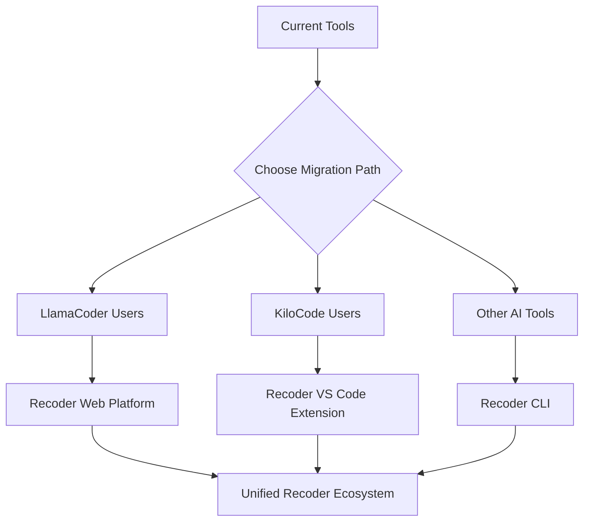

# 🔄 Recoder.xyz Migration Guide

> **Complete guide for migrating from LlamaCoder, KiloCode, and other AI coding tools to the unified Recoder.xyz ecosystem**

## 📋 Table of Contents

1. [🎯 Migration Overview](#-migration-overview)
2. [🔧 Pre-Migration Checklist](#-pre-migration-checklist)
3. [📦 CLI Migration](#-cli-migration)
4. [🌐 Web Platform Migration](#-web-platform-migration)
5. [🔌 VS Code Extension Migration](#-vs-code-extension-migration)
6. [⚙️ Configuration Migration](#-configuration-migration)
7. [📊 Data Migration](#-data-migration)
8. [🔍 Troubleshooting](#-troubleshooting)
9. [📞 Support](#-support)

---

## 🎯 Migration Overview

Recoder.xyz represents the evolution of AI-powered development tools, combining the best features of existing platforms while introducing revolutionary **real, production-ready code generation**.

### What's Different?

| Feature | Legacy Tools | Recoder.xyz |
|---------|-------------|-------------|
| **Code Quality** | Mock implementations | Real, production-ready code |
| **AI Intelligence** | Single provider | Multi-AI routing (Claude, Groq, Gemini, Ollama) |
| **Platform Integration** | Isolated tools | Unified ecosystem (CLI, Web, Extension) |
| **Session Management** | Local only | Cross-platform synchronization |
| **Security** | Basic checks | Advanced vulnerability scanning |
| **Deployment** | Manual setup | One-click deployment |

### Migration Paths



---

## 🔧 Pre-Migration Checklist

### System Requirements

- **Node.js**: Version 18 or higher
- **Operating System**: Windows 10+, macOS 10.15+, or Linux
- **Memory**: Minimum 4GB RAM (8GB recommended)
- **Storage**: At least 2GB free space
- **Internet**: Stable connection for AI provider APIs

### Backup Current Setup

```bash
# Backup existing configurations
mkdir ~/recoder-migration-backup
cp -r ~/.config/existing-tool ~/recoder-migration-backup/
cp -r ~/.vscode/extensions/existing-extension ~/recoder-migration-backup/

# Export current projects (if applicable)
# This varies by tool - see specific sections below
```

### API Keys Preparation

Gather your existing API keys and prepare new ones:

```bash
# Required for full functionality
export ANTHROPIC_API_KEY="your-claude-api-key"
export GROQ_API_KEY="your-groq-api-key"
export GOOGLE_API_KEY="your-gemini-api-key"
export OLLAMA_BASE_URL="http://localhost:11434"  # If using Ollama
```

---

## 📦 CLI Migration

### From LlamaCoder CLI

#### 1. Install Recoder CLI

```bash
# Uninstall old CLI (optional)
npm uninstall -g llamacoder

# Install Recoder CLI
npm install -g @recoder/cli

# Verify installation
recoder --version
```

#### 2. Migrate Configuration

```bash
# Initialize Recoder configuration
recoder config --init

# Import LlamaCoder settings (if available)
recoder config --import ~/.llamacoder/config.json

# Configure AI providers
recoder providers --set-key claude
recoder providers --set-key groq
recoder providers --set-key gemini
```

#### 3. Test Migration

```bash
# Test basic functionality
recoder generate "Hello World API in Express.js"

# Test with different providers
recoder generate "React component for user profile" --provider groq
recoder generate "Security middleware for JWT" --provider claude
```

### From Other CLI Tools

#### Generic Migration Steps

1. **Export Projects**: Most CLI tools store projects in `~/.config/[tool-name]`
2. **Convert Commands**: Use our command mapping guide below
3. **Update Workflows**: Integrate new Recoder commands

#### Command Mapping

| Old Command | Recoder Equivalent | Notes |
|-------------|-------------------|-------|
| `llamacoder create` | `recoder generate` | Enhanced with multi-AI |
| `kilocode new` | `recoder project init` | More comprehensive |
| `cursor chat` | `recoder session create` | Cross-platform sessions |
| `cline generate` | `recoder agent run` | Specialized agents |

---

## 🌐 Web Platform Migration

### From LlamaCoder Web

#### 1. Export Current Projects

```javascript
// Run this in LlamaCoder browser console
const projects = JSON.parse(localStorage.getItem('llamacoder-projects') || '[]');
const exportData = {
  projects: projects,
  settings: JSON.parse(localStorage.getItem('llamacoder-settings') || '{}'),
  exportDate: new Date().toISOString()
};

// Download the data
const blob = new Blob([JSON.stringify(exportData, null, 2)], 
  { type: 'application/json' });
const url = URL.createObjectURL(blob);
const a = document.createElement('a');
a.href = url;
a.download = 'llamacoder-export.json';
a.click();
```

#### 2. Access Recoder Web Platform

1. Navigate to [https://web.recoder.xyz](https://web.recoder.xyz)
2. Sign up or sign in with your preferred method
3. Complete the onboarding process

#### 3. Import Projects

```javascript
// In Recoder Web Platform, go to Settings > Import
// Upload your llamacoder-export.json file
// The system will automatically convert projects to Recoder format
```

#### 4. Configure AI Providers

1. Go to **Settings > AI Providers**
2. Add your API keys for Claude, Groq, Gemini
3. Test each provider connection
4. Set your preferred default provider

### Migration Benefits

- **Enhanced UI**: Modern, responsive design with dark/light themes
- **Real-time Collaboration**: Share projects with team members
- **Advanced Code Preview**: Live preview with syntax highlighting
- **Deployment Integration**: One-click deploy to Vercel, Netlify, etc.

---

## 🔌 VS Code Extension Migration

### From KiloCode Extension

#### 1. Uninstall Old Extension

```bash
# Via command line
code --uninstall-extension kilocode.kilo-code

# Or via VS Code UI:
# Extensions > Search "KiloCode" > Uninstall
```

#### 2. Install Recoder Extension

```bash
# Via command line
code --install-extension recoderxyz.recoder-vscode

# Or via VS Code Marketplace:
# Extensions > Search "Recoder" > Install
```

#### 3. Migrate Settings

The extension will automatically detect and offer to migrate KiloCode settings:

```json
// Old KiloCode settings
{
  "kilo-code.allowedCommands": ["npm test", "git status"],
  "kilo-code.defaultProvider": "claude",
  "kilo-code.customStoragePath": "/path/to/storage"
}

// New Recoder settings (auto-converted)
{
  "recoder.allowedCommands": ["npm test", "git status"],
  "recoder.defaultProvider": "claude",
  "recoder.customStoragePath": "/path/to/storage",
  "recoder.multiAIRouting": true,
  "recoder.realCodeOnly": true
}
```

#### 4. Import Sessions

1. Open Command Palette (`Ctrl+Shift+P` / `Cmd+Shift+P`)
2. Type "Recoder: Import Sessions"
3. Select your KiloCode session export file
4. Choose which sessions to import

### New Features Available

- **Multi-AI Intelligence**: Automatic provider selection based on task
- **Ghost Mode**: Inline code suggestions as you type
- **Cross-Platform Sync**: Sessions sync with CLI and Web Platform
- **Enhanced Security**: Real-time vulnerability scanning
- **Production Focus**: No more mock implementations

### From Other Extensions

#### Cursor IDE Users

1. Export your chat history and settings
2. Install Recoder extension alongside or as replacement
3. Use migration tool: `Recoder: Import from Cursor`

#### GitHub Copilot Users

1. Keep Copilot installed (they work together!)
2. Configure Recoder as primary for complex tasks
3. Use Copilot for simple completions, Recoder for architecture

---

## ⚙️ Configuration Migration

### Unified Configuration System

Recoder uses a unified configuration that works across all platforms:

```typescript
// ~/.recoder/config.json
{
  "version": "1.0.0",
  "aiProviders": {
    "claude": {
      "enabled": true,
      "apiKey": "your-key",
      "models": ["claude-3-5-sonnet-20241022"]
    },
    "groq": {
      "enabled": true,
      "apiKey": "your-key", 
      "models": ["llama-3.1-70b-versatile"]
    }
  },
  "defaultProvider": "claude",
  "intelligentRouting": true,
  "qualityValidation": true,
  "realCodeOnly": true,
  "features": {
    "sessionSharing": true,
    "crossPlatformSync": true
  }
}
```

### Automatic Migration

```bash
# Detect and migrate existing configurations
recoder config --migrate-from llamacoder
recoder config --migrate-from kilocode
recoder config --migrate-from cursor

# Validate migrated configuration
recoder config --validate

# Manual configuration if needed
recoder config --setup-wizard
```

---

## 📊 Data Migration

### Session and Project Migration

#### Export Data from Legacy Tools

```bash
# For CLI tools
recoder-migrate export --from llamacoder --output ./migration-data.json
recoder-migrate export --from kilocode --output ./migration-data.json

# For web platforms
# Use browser export scripts (provided above)
```

#### Import to Recoder

```bash
# Import sessions
recoder session --import ./migration-data.json

# Import projects
recoder project --import ./migration-data.json

# Verify import
recoder session --list
recoder project list
```

### Data Conversion Process

1. **Format Detection**: Automatically detects source format
2. **Schema Mapping**: Converts to Recoder's unified schema
3. **Validation**: Ensures data integrity
4. **Enhancement**: Adds new Recoder features to existing data

### What Gets Migrated

✅ **Migrated Successfully**
- Project structures and files
- Chat/session histories
- Configuration settings
- API keys (encrypted)
- Custom prompts and templates

⚠️ **Requires Manual Setup**
- Third-party integrations
- Custom plugins/extensions
- Specific deployment configurations
- Advanced workflow automations

❌ **Not Migrated**
- Temporary cache files
- Local-only experimental features
- Deprecated settings

---

## 🔍 Troubleshooting

### Common Migration Issues

#### Issue: "API Key Not Working"

```bash
# Test API key validity
recoder providers --test claude
recoder providers --test groq

# Re-configure if needed
recoder providers --set-key claude
```

#### Issue: "Sessions Not Importing"

```bash
# Check file format
recoder session --validate-import ./sessions.json

# Try manual import
recoder session --import ./sessions.json --force

# Check logs
recoder --verbose session --import ./sessions.json
```

#### Issue: "Extension Not Loading"

1. Check VS Code version compatibility
2. Restart VS Code after installation
3. Check for conflicting extensions
4. Review extension logs: `View > Output > Recoder`

#### Issue: "Configuration Conflicts"

```bash
# Reset to defaults
recoder config --reset

# Rebuild configuration
recoder config --setup-wizard

# Import specific settings
recoder config --import ./backup-config.json --merge
```

### Performance Issues

#### Slow Code Generation

1. **Check Provider Status**:
   ```bash
   recoder providers --status
   ```

2. **Optimize Provider Selection**:
   ```bash
   # Use faster providers for simple tasks
   recoder generate "simple function" --provider groq
   
   # Use powerful providers for complex tasks
   recoder generate "enterprise architecture" --provider claude
   ```

3. **Enable Caching**:
   ```bash
   recoder config --set caching.enabled true
   ```

#### Memory Issues

1. **Increase Node.js Memory**:
   ```bash
   export NODE_OPTIONS="--max-old-space-size=8192"
   ```

2. **Clean Cache**:
   ```bash
   recoder --clear-cache
   ```

---

## 📞 Support

### Self-Help Resources

- **📖 Documentation**: [https://docs.recoder.xyz](https://docs.recoder.xyz)
- **🎥 Video Tutorials**: [YouTube Channel](https://youtube.com/@recoderxyz)
- **💬 Community Forum**: [GitHub Discussions](https://github.com/recoderxyz/recoder/discussions)
- **📝 Migration FAQ**: [FAQ Page](https://recoder.xyz/faq)

### Direct Support

#### Migration Assistance

For complex migrations, we offer **free migration assistance**:

1. **Schedule a call**: [calendly.com/recoder-migration](https://calendly.com/recoder-migration)
2. **Email support**: migration@recoder.xyz
3. **Discord community**: [discord.gg/recoder](https://discord.gg/recoder)

#### Enterprise Migration

For teams and enterprises:

- **Dedicated migration specialist**
- **Custom migration scripts**
- **Team training sessions**
- **Priority support**

Contact: enterprise@recoder.xyz

### Bug Reports

Found an issue during migration?

1. **Check existing issues**: [GitHub Issues](https://github.com/recoderxyz/recoder/issues)
2. **Create detailed bug report** with:
   - Source tool and version
   - Migration step where issue occurred
   - Error messages and logs
   - Expected vs actual behavior

### Feature Requests

Missing a feature from your previous tool?

1. **Search existing requests**: [Feature Requests](https://github.com/recoderxyz/recoder/discussions/categories/ideas)
2. **Submit new request** with:
   - Clear description of feature
   - Use case and benefits
   - Comparison with previous tool

---

## 🎉 Post-Migration

### Verification Checklist

- [ ] All platforms installed and configured
- [ ] API keys working for all providers
- [ ] Sessions and projects imported successfully
- [ ] Cross-platform sync functioning
- [ ] Team members migrated (if applicable)
- [ ] Workflows updated with new commands
- [ ] Documentation bookmarked

### Getting the Most Out of Recoder

1. **Explore Multi-AI Features**:
   ```bash
   # Let Recoder choose the best AI for your task
   recoder generate "complex backend architecture" --auto-provider
   ```

2. **Use Cross-Platform Sync**:
   - Start a project in CLI
   - Continue in Web Platform
   - Finish in VS Code Extension

3. **Leverage Real Code Generation**:
   - Request actual database operations
   - Ask for real API integrations
   - Generate production-ready deployments

4. **Join the Community**:
   - Share your migration experience
   - Help other users migrate
   - Suggest improvements and features

---

**Welcome to the future of AI-powered development with Recoder.xyz! 🚀**

*Need help? Don't hesitate to reach out to our friendly community and support team.*