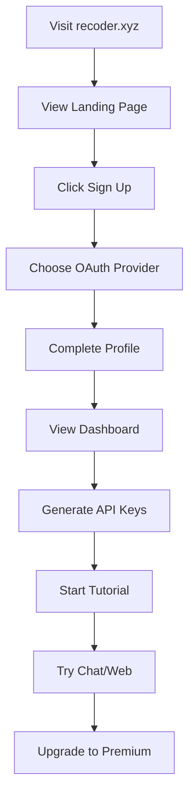
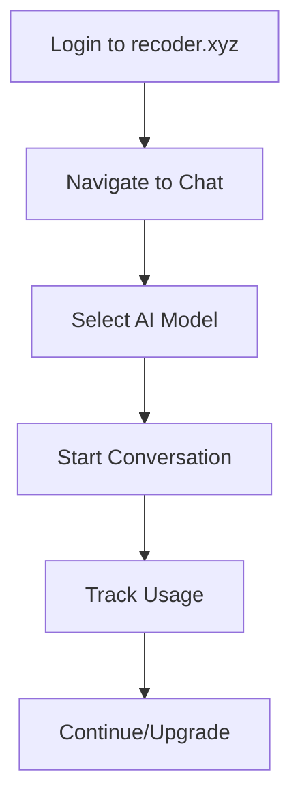
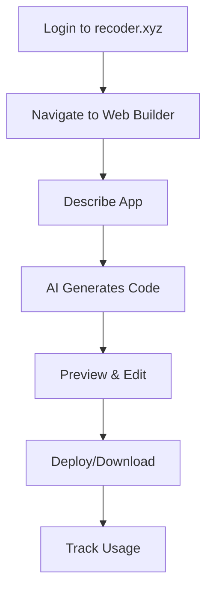
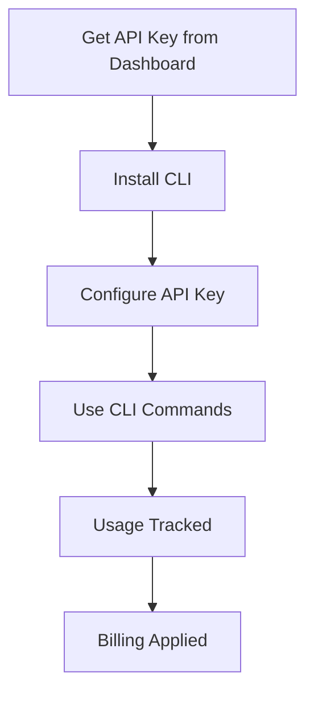
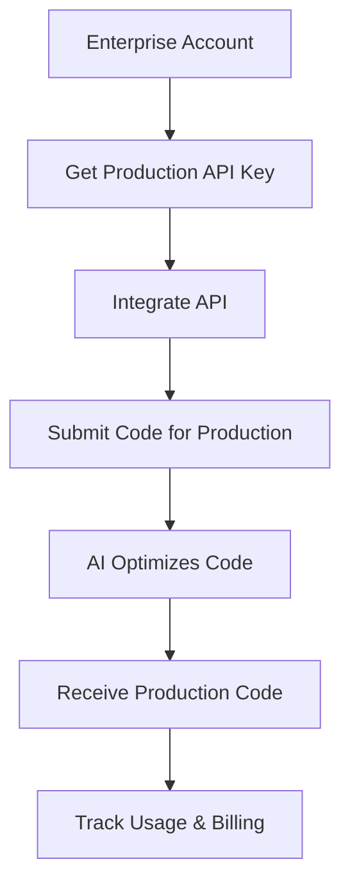

# 🚀 Recoder.xyz Comprehensive Development Plan

## 📋 Executive Summary

Transform recoder.xyz into a unified AI development ecosystem with centralized authentication, API key management, and premium subscription system supporting 5 integrated platforms.

---

## 🏗️ Platform Architecture Overview

```
recoder.xyz (Main Hub)
├── 🌐 Main Website (Landing + Auth)
├── 💬 Recoder Chat (Multi-AI ChatGPT)
├── 🛠️ Recoder Web (AI App Builder)
├── ⚙️ CLI Router Package (API)
├── 🔧 CLI Main Package (API)
└── 🏭 Production Engine (DAAS API)
```

---

## 🎯 PHASE 1: Core Infrastructure (Week 1-2)

### 1.1 Unified Authentication System

**🔐 Auth Requirements:**
- Google OAuth integration
- GitHub OAuth integration  
- Email/password registration
- JWT token management
- API key generation per user
- Premium tier management
- Usage tracking per API key

**🗄️ Database Schema:**
```sql
users (
  id, email, name, avatar_url, 
  provider, provider_id, tier, 
  created_at, updated_at
)

api_keys (
  id, user_id, key_hash, name, 
  platform, usage_limit, usage_count,
  is_active, created_at, expires_at
)

subscriptions (
  id, user_id, stripe_customer_id, 
  plan, status, current_period_end,
  created_at, updated_at
)

usage_logs (
  id, api_key_id, platform, 
  model_used, tokens, cost,
  timestamp
)
```

### 1.2 Main Website (recoder.xyz)

**📄 Required Pages:**
```
/ (Landing page with value proposition)
/auth/login (OAuth + email login)
/auth/register (OAuth + email signup)
/dashboard (User portal)
/api-keys (API key management)
/billing (Subscription management)
/usage (Usage analytics)
/docs/cli-router (CLI Router docs)
/docs/cli (Main CLI docs)
/docs/production-engine (Production Engine docs)
/docs/chat (Chat platform docs)
/docs/web (Web builder docs)
/pricing (Subscription tiers)
/chat (Redirect to chat app)
/web (Redirect to web builder)
```

---

## 🎯 PHASE 2: Platform Integration & API Management (Week 2-3)

### 2.1 API Key Management System

**🔑 API Key Features:**
- Platform-specific keys (CLI Router, CLI Main, Production Engine)
- Usage limits per tier (Free: 1K requests/month, Premium: 100K, Pro: Unlimited)
- Real-time usage tracking
- Automatic key rotation
- Rate limiting per key
- Cost calculation per request

**💰 Pricing Tiers:**
```typescript
const PRICING_TIERS = {
  free: {
    requests: 1000,
    platforms: ['chat'],
    models: ['basic'],
    price: 0
  },
  premium: {
    requests: 100000,
    platforms: ['chat', 'web', 'cli-router'],
    models: ['all'],
    price: 20
  },
  pro: {
    requests: -1, // unlimited
    platforms: ['all'],
    models: ['all'],
    features: ['production-engine'],
    price: 100
  }
}
```

### 2.2 Platform API Standardization

**🔌 Unified API Structure:**
```typescript
// All platforms use same auth pattern
headers: {
  'Authorization': 'Bearer {api_key}',
  'X-Platform': 'cli-router|cli-main|production-engine',
  'X-User-ID': '{user_id}'
}

// Standard response format
response: {
  success: boolean,
  data: any,
  usage: {
    tokens_used: number,
    cost: number,
    remaining: number
  },
  errors?: string[]
}
```

---

## 🎯 PHASE 3: Fix Current Applications (Week 3-4)

### 3.1 Recoder Chat Fixes

**🐛 Current Issues & Solutions:**
- **Issue**: AI connections not working
- **Solution**: Implement proper API key routing and model selection

**🔧 Required Fixes:**
```typescript
// Fix AI provider connections
const AI_PROVIDERS = {
  openai: { baseURL: 'https://api.openai.com/v1', models: ['gpt-4', 'gpt-3.5-turbo'] },
  anthropic: { baseURL: 'https://api.anthropic.com/v1', models: ['claude-3-sonnet'] },
  groq: { baseURL: 'https://api.groq.com/openai/v1', models: ['llama-70b'] },
  together: { baseURL: 'https://api.together.xyz/v1', models: ['qwen-coder'] }
}

// Fix message handling
async function sendMessage(message: string, model: string, apiKey: string) {
  const provider = getProviderByModel(model);
  const response = await fetch(`${provider.baseURL}/chat/completions`, {
    method: 'POST',
    headers: {
      'Authorization': `Bearer ${apiKey}`,
      'Content-Type': 'application/json'
    },
    body: JSON.stringify({
      model,
      messages: [{ role: 'user', content: message }]
    })
  });
  
  return response.json();
}
```

### 3.2 Recoder Web Fixes

**🐛 Current Issues & Solutions:**
- **Issue**: Not generating apps
- **Solution**: Implement proper code generation pipeline with file management

**🔧 Required Fixes:**
```typescript
// Fix app generation
async function generateApp(prompt: string, apiKey: string) {
  // 1. Generate project structure
  const structure = await generateProjectStructure(prompt, apiKey);
  
  // 2. Generate individual files
  const files = await Promise.all(
    structure.files.map(file => generateFile(file, prompt, apiKey))
  );
  
  // 3. Create preview environment
  const previewUrl = await createPreview(files);
  
  return { files, previewUrl, structure };
}

// Fix file management
class FileManager {
  async createFile(path: string, content: string) { /* implement */ }
  async updateFile(path: string, content: string) { /* implement */ }
  async deleteFile(path: string) { /* implement */ }
  async getFileTree() { /* implement */ }
}
```

---

## 🎯 PHASE 4: Enhanced Authentication (Week 4-5)

### 4.1 OAuth Integration

**🔐 Google OAuth Setup:**
```typescript
// Google OAuth configuration
const googleConfig = {
  clientId: process.env.GOOGLE_CLIENT_ID,
  clientSecret: process.env.GOOGLE_CLIENT_SECRET,
  redirectUri: 'https://recoder.xyz/auth/google/callback'
}

// OAuth flow implementation
app.get('/auth/google', (req, res) => {
  const authUrl = `https://accounts.google.com/oauth/authorize?` +
    `client_id=${googleConfig.clientId}&` +
    `redirect_uri=${googleConfig.redirectUri}&` +
    `response_type=code&` +
    `scope=email profile`;
  res.redirect(authUrl);
});
```

**🔐 GitHub OAuth Setup:**
```typescript
// GitHub OAuth configuration
const githubConfig = {
  clientId: process.env.GITHUB_CLIENT_ID,
  clientSecret: process.env.GITHUB_CLIENT_SECRET,
  redirectUri: 'https://recoder.xyz/auth/github/callback'
}
```

### 4.2 JWT & Session Management

**🎫 Token System:**
```typescript
// JWT token structure
interface JWTPayload {
  userId: string;
  email: string;
  tier: 'free' | 'premium' | 'pro';
  apiKeys: string[];
  exp: number;
}

// Session management
class SessionManager {
  async createSession(user: User): Promise<string> { /* implement */ }
  async validateSession(token: string): Promise<User | null> { /* implement */ }
  async refreshSession(token: string): Promise<string> { /* implement */ }
  async destroySession(token: string): Promise<void> { /* implement */ }
}
```

---

## 🎯 PHASE 5: Documentation & User Experience (Week 5-6)

### 5.1 Complete Documentation

**📚 Documentation Structure:**
```
/docs
├── /getting-started
│   ├── quick-start.md
│   ├── authentication.md
│   └── api-keys.md
├── /cli-router
│   ├── installation.md
│   ├── configuration.md
│   ├── usage.md
│   └── api-reference.md
├── /cli-main
│   ├── installation.md
│   ├── commands.md
│   ├── examples.md
│   └── troubleshooting.md
├── /production-engine
│   ├── overview.md
│   ├── api-reference.md
│   ├── examples.md
│   └── pricing.md
├── /chat
│   ├── features.md
│   ├── models.md
│   └── usage.md
└── /web
    ├── app-builder.md
    ├── templates.md
    └── deployment.md
```

### 5.2 User Onboarding Flow

**🚀 Onboarding Sequence:**
1. **Landing Page** → Value proposition with clear CTAs
2. **Sign Up** → OAuth or email registration
3. **Welcome** → Platform overview and tour
4. **API Keys** → Generate first API keys
5. **First Project** → Guided tutorial
6. **Upgrade Prompt** → Premium features showcase

---

## 📊 Comprehensive User Flows

### 🔄 User Flow 1: New User Onboarding



### 🔄 User Flow 2: Existing User - Chat Platform



### 🔄 User Flow 3: Existing User - Web Builder



### 🔄 User Flow 4: Developer - CLI Usage



### 🔄 User Flow 5: Enterprise - Production Engine



---

## ✅ COMPREHENSIVE TODO LIST

### 🔴 CRITICAL PRIORITY (Week 1)

#### Authentication & Infrastructure
- [ ] **Set up main database with user, api_keys, subscriptions, usage_logs tables**
- [ ] **Implement Google OAuth integration with proper callback handling**
- [ ] **Implement GitHub OAuth integration with proper callback handling**
- [ ] **Create JWT token management system with refresh logic**
- [ ] **Build API key generation system with platform-specific keys**
- [ ] **Implement usage tracking middleware for all API calls**
- [ ] **Set up Stripe integration for subscription management**

#### Main Website (recoder.xyz)
- [ ] **Fix landing page with clear value proposition and CTAs**
- [ ] **Build user dashboard with API key management**
- [ ] **Create billing page with subscription options**
- [ ] **Build usage analytics page with charts and limits**
- [ ] **Implement responsive design for all pages**

### 🟡 HIGH PRIORITY (Week 2)

#### Recoder Chat Fixes
- [ ] **Debug and fix AI provider connections (OpenAI, Anthropic, Groq)**
- [ ] **Implement proper message handling with streaming responses**
- [ ] **Add model selection dropdown with available models**
- [ ] **Fix authentication integration with main site**
- [ ] **Add conversation history persistence**
- [ ] **Implement real-time typing indicators**
- [ ] **Add conversation sharing functionality**

#### Recoder Web Fixes
- [ ] **Fix app generation pipeline with proper file structure**
- [ ] **Implement file manager with create/edit/delete operations**
- [ ] **Add live preview functionality with iframe sandboxing**
- [ ] **Fix authentication integration with main site**
- [ ] **Add project saving and loading functionality**
- [ ] **Implement template system for common app types**
- [ ] **Add deployment options (Vercel, Netlify)**

### 🟢 MEDIUM PRIORITY (Week 3)

#### API Platform Standardization
- [ ] **Create unified API gateway for all platforms**
- [ ] **Implement rate limiting per API key**
- [ ] **Add request logging and analytics**
- [ ] **Create API documentation with Swagger/OpenAPI**
- [ ] **Implement API key rotation system**
- [ ] **Add webhook system for usage notifications**

#### CLI Integration
- [ ] **Update CLI Router to use new authentication system**
- [ ] **Update CLI Main to use new authentication system**
- [ ] **Add usage tracking to both CLI packages**
- [ ] **Implement automatic API key configuration**
- [ ] **Add subscription checking for premium features**

### 🔵 NICE TO HAVE (Week 4-5)

#### Production Engine Integration
- [ ] **Build DAAS API with code optimization endpoints**
- [ ] **Implement security scanning for generated code**
- [ ] **Add performance optimization suggestions**
- [ ] **Create deployment pipeline integration**
- [ ] **Add code quality scoring system**

#### Documentation & Support
- [ ] **Write comprehensive API documentation**
- [ ] **Create video tutorials for each platform**
- [ ] **Build interactive getting started guide**
- [ ] **Add in-app help system and tooltips**
- [ ] **Create troubleshooting knowledge base**

#### Advanced Features
- [ ] **Add team collaboration features**
- [ ] **Implement enterprise SSO integration**
- [ ] **Add usage analytics dashboard for enterprises**
- [ ] **Build admin panel for user management**
- [ ] **Add A/B testing framework for UI improvements**

### 🟣 FUTURE ENHANCEMENTS (Week 6+)

#### Mobile Applications
- [ ] **Build React Native app for recoder chat**
- [ ] **Create mobile-optimized web builder**
- [ ] **Add push notifications for usage alerts**

#### Enterprise Features
- [ ] **Build white-label solutions**
- [ ] **Add audit logging for compliance**
- [ ] **Implement custom model training**
- [ ] **Add advanced security features**

---

## 🔧 Technical Implementation Priority

### Week 1: Foundation
1. Database setup and migrations
2. Authentication system (Google/GitHub OAuth)
3. JWT token management
4. API key generation system

### Week 2: Core Fixes
1. Fix Recoder Chat AI connections
2. Fix Recoder Web app generation
3. Integrate authentication across all platforms
4. Implement usage tracking

### Week 3: Platform Integration
1. Standardize API responses
2. Add rate limiting and monitoring
3. Update CLI packages with new auth
4. Build unified dashboard

### Week 4: Polish & Documentation
1. Complete documentation
2. Add user onboarding flow
3. Implement billing system
4. Performance optimization

### Week 5: Testing & Launch
1. End-to-end testing
2. Security audit
3. Performance testing
4. Soft launch with beta users

---

## 📊 Success Metrics

### Technical KPIs
- [ ] All platforms have working authentication
- [ ] AI connections working with >95% success rate
- [ ] API response time <500ms average
- [ ] Zero security vulnerabilities
- [ ] Mobile responsive design score >90

### Business KPIs
- [ ] User registration rate >10% from landing page
- [ ] Free to premium conversion rate >5%
- [ ] API usage growth >20% month-over-month
- [ ] Customer support tickets <2% of total users
- [ ] Platform uptime >99.9%

This comprehensive plan addresses all current issues while building a scalable foundation for future growth. Each phase builds upon the previous one, ensuring a stable progression toward a fully integrated AI development ecosystem.